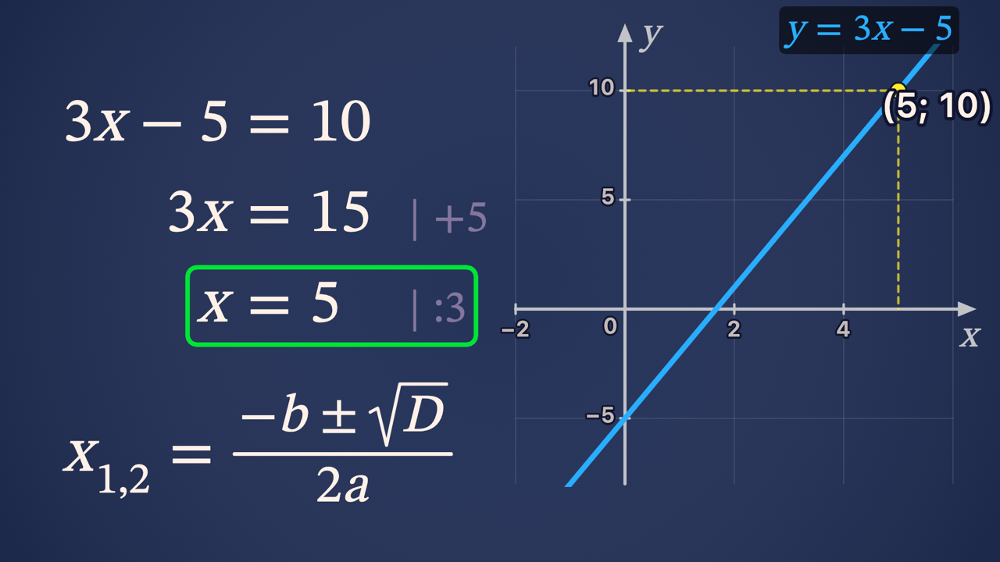
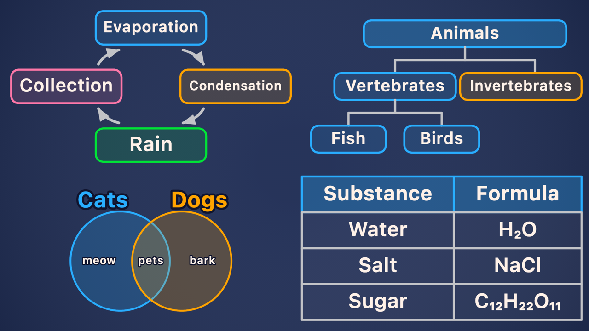

# UpBilim Board

A vector whiteboard for **AI tutors**. A language model explains out loud and draws at the same time, with short JSON commands, the way a teacher works at a whiteboard:

- **Drawn live, like a marker.** Every object appears over time: the stroke is drawn from start to end, the fill fades in under it, text is written left to right, and a marker follows the tip of the line. Crisp vector graphics at any size.
- **Textbook math.** Formulas with fractions, roots, powers, indices, systems, scaled brackets, colors, boxed answers and crossed-out terms (a small built-in TeX: no fonts or libraries to load). Worked solutions where every new line lines up under the previous one at the `=` sign, with "what we did" notes on the right.
- **Graphs and geometry.** Coordinate planes, function plots (`"fn": "x^2 - 2"`, parsed safely without `eval`), points with projections, number lines and intervals, vertex names, equal-side ticks, side lengths, angles and right angles.
- **Diagrams with automatic layout.** `cycle`, `flow`, `timeline`, `compare`, `tree`, `venn`, `table`: the model names the structure and the content, and the board places blocks and arrows without overlaps. Every part gets an id (`s.1`, `s.2`…) so the model can point at it while it talks.
- **A live board.** Objects can move (orbit, fall, rise, swing, spin, pulse, blink), be highlighted, circled with the marker and erased. Ready-made objects (pendulum, atom, wave, road, zebra crossing, traffic light) and 21 icons.
- **Board memory for the model.** `board.scene()` returns a short text: what is on the board, its id, where it is, and the free areas. Send it with the next question, and the model continues the same drawing exactly instead of starting over.




It is the board of **Bilimai**, the AI teacher of [UpBilim](https://upbilim.com). The command language is small and predictable on purpose: it is cheap in tokens and easy for a language model to write correctly.

## Quick start

```html
<!doctype html>
<meta charset="utf-8">
<canvas id="board" style="width: 100%; max-width: 960px; aspect-ratio: 16 / 9; border-radius: 12px"></canvas>
<script type="module">
  import { Board } from 'https://cdn.jsdelivr.net/gh/UpBilim/board@v0.1.0/dist/upbilim-board.js';

  const board = new Board(document.getElementById('board'), (title) => console.log('title:', title));

  const commands = [
    { op: 'title', s: 'Linear equation' },
    { op: 'step', id: 'sol', x: 20, y: 30, s: '3x - 5 = 10' },
    { op: 'step', id: 'sol', s: '3x = 15', note: '+5' },
    { op: 'step', id: 'sol', s: 'x = 5', note: ':3' },
    { op: 'mark', id: 'sol.3', style: 'box', c: '#00E436' },
    { op: 'axes', id: 'ax', x: 165, y: 15, w: 140, h: 140, xmin: -2, xmax: 6, ymin: -8, ymax: 12 },
    { op: 'plot', axes: 'ax', id: 'f', fn: '3x - 5', c: '#29ADFF', s: 'y = 3x - 5' },
    { op: 'dot', axes: 'ax', x: 5, y: 10, s: '(5; 10)', proj: true },
  ];
  commands.forEach((c, i) => setTimeout(() => board.draw(c), i * 700));
</script>
```

Or install it: `npm install github:UpBilim/board` and `import { Board } from 'upbilim-board'`.

Open [`examples/index.html`](examples/index.html) to see every feature (serve the folder: `npm run serve`).

## API

```ts
const board = new Board(canvas, onTitle?)   // onTitle(text): show the diagram title above the board, outside the drawing
board.draw(cmd)        // one command; it animates in
board.drawAll(cmds)    // many commands at once, without animation (e.g. a late joiner sees the finished board)
board.scene()          // text for the model: ids, kinds, positions, labels, coordinate systems, free areas
board.clear(bg?)       // empty board
board.destroy()        // stop the render loop
```

The canvas is rendered at 1920×1080; size it with CSS (16:9). Commands use a **320×180 grid** (origin top-left, decimals allowed): small numbers mean fewer tokens and fewer mistakes for the model.

## Using it with a language model

1. Put the command reference ([`docs/COMMANDS.md`](docs/COMMANDS.md)) into the system prompt and ask the model to answer in lines, for example `SAY: <sentence>` and `DRAW: <one JSON command>`.
2. Stream the answer. Speak each `SAY` line (any text-to-speech) and apply its `DRAW` lines while that sentence plays: spread them over its duration and the drawing keeps pace with the voice.
3. Before the next question, call `board.scene()` and add it to the prompt ("The board now: …; continue the same drawing, point at objects by id, use free areas"). The model then builds on the board instead of redrawing it.

Tips that work well in practice:

- Ask for one `schema` command for any structure (cycle, steps, timeline, comparison, classification, sets, table) instead of hand-made rectangles and arrows.
- Ask for `formula` / `step` for every formula and calculation, and to say numbers in words in the spoken text.
- LaTeX inside JSON needs doubled backslashes (`"\\frac{1}{2}"`). Models sometimes forget; before `JSON.parse`, double a lone backslash that stands before a letter.

## Browser support

Any modern browser with Canvas 2D (Chrome, Edge, Firefox, Safari, mobile browsers). No dependencies. The render loop sleeps when nothing moves, which matters on phones.

## Versioning

The board is young: versions stay `0.x` while the command language may still change.

## License

[Apache License 2.0](LICENSE). You may use it in commercial and closed products. Keep the [NOTICE](NOTICE) file with the license and state your changes, as the license requires.

Copyright 2026 [UpBilim](https://upbilim.com).
